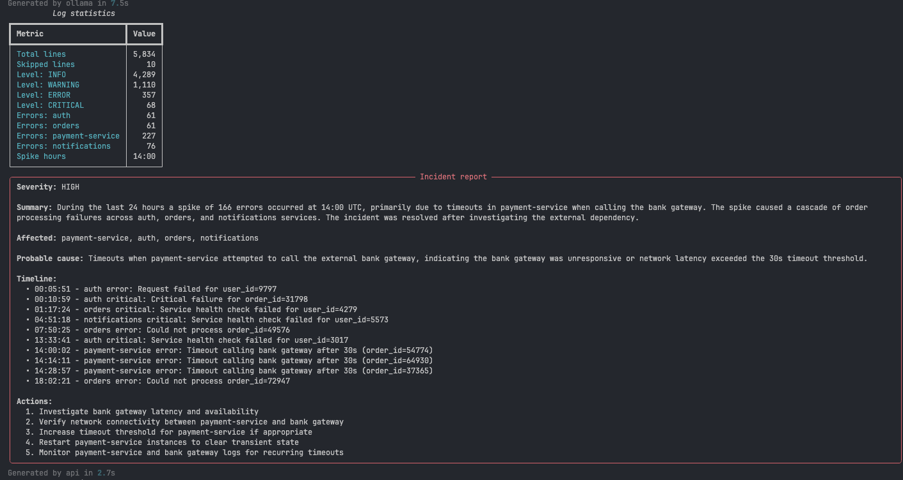
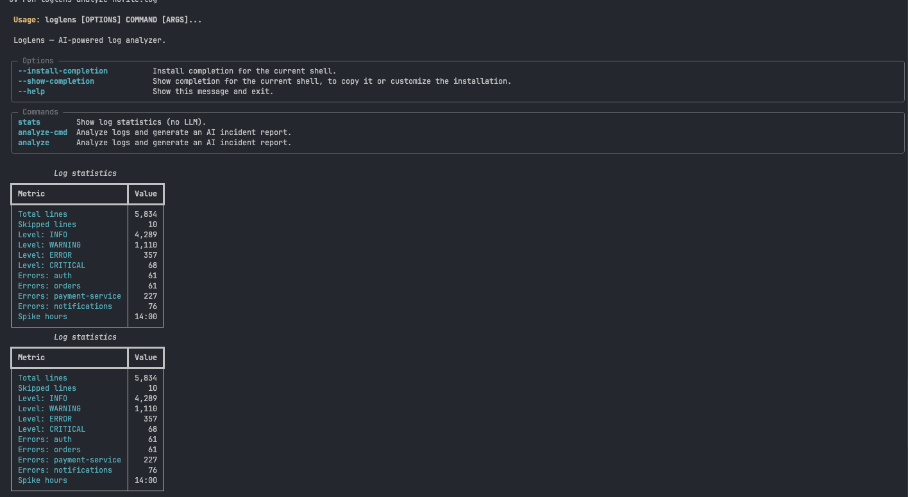
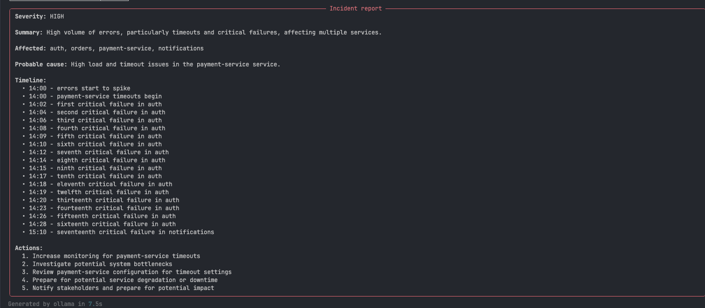

# LogLens

AI-powered command-line tool that turns raw server logs into a validated incident report.

LogLens parses a log file, computes statistics, picks representative error samples, and asks an LLM (local or cloud) to write a structured incident report — validated against a Pydantic schema, with an automatic self-correction retry.



## How it works

```text
app.log → regex parser → stats + spike detection → smart error sampling
        → prompt (stats + samples + JSON schema) → LLM (Ollama or API)
        → Pydantic validation (1 self-correcting retry) → terminal report + report.json
```

## Features

- **Robust parsing** — regex with named groups; malformed lines are counted and skipped, never crash the run
- **Statistics** — counts per level, errors per service, top error patterns (IDs normalized), errors per hour
- **Spike detection** — flags hours with more than 3× the average error rate
- **Smart sampling** — half the sample budget goes to spike hours, the rest covers every distinct error pattern
- **Provider abstraction** — switch between a local model (Ollama) and any OpenAI-compatible API with one flag
- **Structured output** — LLM response validated by Pydantic; on failure the validation errors are sent back for one fix attempt
- **Clean CLI** — `typer` commands with `rich` tables, panels and timing

## Quick start

Requirements: [uv](https://docs.astral.sh/uv/), [Ollama](https://ollama.com) (for local mode), and optionally an API key from any OpenAI-compatible provider.

```bash
git clone https://github.com/<your-username>/loglens.git
cd loglens
uv sync

# local model
ollama pull qwen2.5:3b

# config
cp .env.example .env   # then fill in your values

# sample data (5,800+ lines with a simulated payment outage at 14:00)
uv run python scripts/make_sample_log.py
```

`.env` keys:

```text
API_KEY=
BASE_URL=https://api.groq.com/openai/v1
MODEL=openai/gpt-oss-20b
OLLAMA_URL=http://localhost:11434
OLLAMA_MODEL=qwen2.5:3b
```

## Usage

```bash
uv run loglens --help
uv run loglens stats samples/app.log
uv run loglens analyze samples/app.log --provider ollama
uv run loglens analyze samples/app.log -p api -o report.json
```



## Results

### Token reduction

Sending the raw log to the model is not an option — it would overflow a small model's context window and multiply API cost.

| Input | Tokens |
| --- | --- |
| Raw log file | 150,555 |
| Compact prompt (stats + 29 samples + schema) | 1,472 |
| **Reduction** | **102×** |

### Local vs cloud model

Same log, same prompt, temperature 0.1.

| | Ollama — `qwen2.5:3b` | Groq — `openai/gpt-oss-20b` |
| --- | --- | --- |
| Latency | 7.5 s | 2.7 s |
| Valid JSON | ✅ | ✅ |
| Severity | high ✅ | high ✅ |
| Probable cause | ❌ "high load" (not in data) | ✅ bank gateway timeouts |
| Timeline | ❌ mislabels payment errors as `auth` | ⚠️ mixes in background noise |
| Hallucinations | invented cause, wrong service | invented "cascade" and "resolved" |



**Key takeaway:** a schema guarantees the *shape* of the output, not its *truth*. Both models returned valid JSON; both made factual mistakes. That is why the next step is automated evaluation.

## Project structure

```text
loglens/
├── scripts/make_sample_log.py   # synthetic log generator (seeded, reproducible)
├── src/loglens/
│   ├── models.py                # LogEntry dataclass
│   ├── parser.py                # line → LogEntry
│   ├── stats.py                 # counts, top errors, spike detection
│   ├── prompts.py               # system prompt, sampling, user prompt
│   ├── llm.py                   # Ollama + OpenAI-compatible clients
│   ├── schemas.py               # IncidentReport (Pydantic)
│   ├── analyzer.py              # pipeline + validation retry
│   └── cli.py                   # typer CLI
└── tests/test_parser.py
```

## Tests

```bash
uv run pytest -v
```

## What I learned

- Relative paths resolve against the terminal's working directory, not the script — anchor paths with `Path(__file__)`
- Check the data before blaming the model: my first synthetic incident was too weak to detect
- Token budgeting matters: computing stats in code gave a 102× smaller prompt
- Structured output needs defensive parsing (strip code fences) and a retry that feeds back the exact validation errors
- Valid JSON ≠ correct answer — LLM output has to be evaluated, not just validated

## Next steps

- [ ] Compute incident facts in code (baseline rate, affected services) so the LLM only explains them
- [ ] Golden set of synthetic incidents + accuracy score per field
- [ ] Stream tokens to the terminal
- [ ] Analyze multiple log files (one per service) and merge them
- [ ] FastAPI `POST /analyze` endpoint

## License

MIT